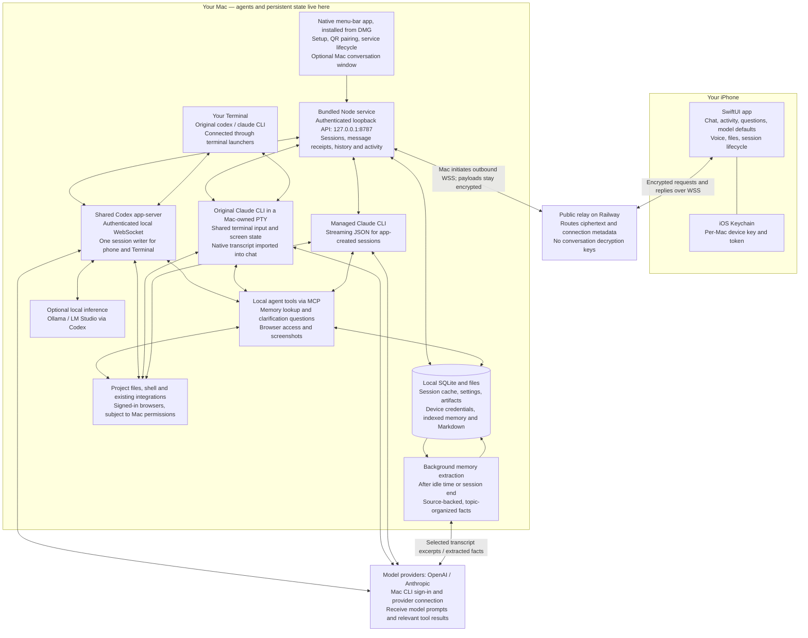

# Agent Remote: architecture and security

Current implementation: September 7, 2026 — Mac 0.6.7, iPhone 0.4.4.

Agent Remote makes the phone another interface to agents running on your Mac. The Mac owns the processes, files, history and memory; the public relay transports encrypted messages. The important security boundary is **who can pair and send commands**, because an authorized phone can direct agents with substantial access to the Mac.

## Architecture

Arrows show logical communication, not a separate listening port for every box. Phone–Mac payload encryption spans both relay connections: decryption happens on the phone or Mac. Model-provider traffic is a separate connection and a separate trust boundary.

## How the pieces behave

| Piece | What it does today |
| --- | --- |
| iPhone | Lists sessions by latest completed message, opens newly created sessions, renders Markdown and activity, sends messages, interrupts/ends/deletes sessions, changes defaults for future sessions, and handles supported files, voice and questions. The Mac keeps working when the phone backgrounds. Push notifications are not implemented. |
| Mac app and DMG | Bundles the native wrapper, Node runtime and service. Setup helps install/sign in to the provider CLIs and enable Terminal integration. The optional Mac chat window uses the same local service. The iPhone app is installed separately. |
| Codex sharing | The integrated original CLI and phone use one local app-server. Provider-native context management and compaction remain with Codex. |
| Claude sharing | The original CLI runs inside a service-owned pseudo-terminal. Both devices can send input without a persistent “phone has control” state. Phone paste and Enter are serialized; draft checks avoid overwriting desktop input. Native Claude retains its slash commands, configuration and compaction. No Channels service is required. |
| Managed Claude | App-created conversations also have a structured streaming-JSON execution path, including supported question cards. Native AskUserQuestion dialogs in shared terminals become question cards whose answers are typed into the dialog by the Mac, with each key verified against the rendered screen; permission prompts still use the phone's optional Terminal controls. Shared Claude terminal chat does not yet support file/photo delivery. |
| Discovery and lifecycle | Existing provider transcripts appear in the session list. An independently running client cannot always be taken over: it may need to exit and resume through the launcher. End stops managed activity and retains history; Delete additionally removes the session's saved data, artifacts and associated memory. Project working files are kept. |
| Local tools | Memory search, topic discovery and supported clarification cards run through a local MCP server. Browser tools can use existing signed-in Chrome/Safari tabs; screenshots and browser automation remain subject to Mac/browser permissions. Agents can also use their existing integrations. |
| Availability | The Mac must be awake, online and running Agent Remote for phone access. Relay failure blocks remote access. Quitting the Mac app also stops its hosted agents. Reopening it does not automatically resurrect a stopped process. |

## Automatic memory

The memory database and readable Markdown exports live under `~/Library/Application Support/AgentRemote/`. There is no separate hosted Agent Remote memory database.

1. Conversation text is indexed locally. A background worker considers idle sessions after roughly two minutes, or ended sessions, polling every 30 seconds and processing bounded batches.
2. A restricted extraction process asks the existing model provider for useful facts, decisions and progress, with exact source quotes and hierarchical topics such as `work/organization/analytics/metrics`. Claude extraction uses `claude-sonnet-5-5`; Codex extraction uses its configured/default model unless separately overridden.
3. The Mac validates and stores the result. Assistant reports are labeled provisional; only temporary progress entries expire; facts and decisions persist regardless of source. Credential-pattern redaction and source checks reduce mistakes but cannot guarantee that every secret or incorrect inference is caught.
4. In later conversations, hidden instructions ask the agent to search relevant local memory as needed. Search returns bounded excerpts and sources, including recent original messages so corrections can be found. There is no required topic picker or visible introductory biography. Retrieval remains model-driven, not guaranteed perfect recall.

**Local storage does not mean local-only processing.** Memory extraction sends selected conversation excerpts to the provider, and recalled material becomes part of the agent's model context. Normal cloud-model conversations also leave the Mac. The optional local inference route is implemented but has not been exercised end to end here; selecting it is not a verified guarantee that every background feature runs locally.

Topics organize retrieval; they are not security partitions between projects, employers or paired devices. A paired device has broad access to this Mac's Agent Remote data. Forgetting a memory or deleting a session cannot retract information already sent to a provider or incorporated into another conversation.

## Why internet access is meaningfully protected

The design avoids publishing an unauthenticated agent-control port on your Mac. These protections are implemented:

| Threat | Protection and its boundary |
| --- | --- |
| Someone scans your public IP | The desktop API binds to loopback only. The Mac initiates an outbound relay connection; no router port forwarding is required. This does not defend against malicious software already running as your Mac user. |
| Someone learns the public relay address | The address alone grants no access. Pairing needs a secret from a single-use QR invitation that expires after five minutes. Treat a still-valid QR image as a credential. |
| Someone impersonates the Mac at the relay | The relay challenges the Mac to sign with its Ed25519 identity key; its routing identity is derived from the public key. The QR transfers the intended host identity to the phone. |
| Relay operator or network attacker reads/changes messages | Pairing uses ephemeral X25519 key agreement and HKDF to establish a device-specific secret. Requests, replies and files use AES-256-GCM, with authenticated routing fields and separate directional keys, in addition to WSS transport encryption. The relay cannot normally decrypt or forge conversation payloads. |
| Someone replays a captured command | Authenticated timestamps and a persistent receive ledger reject expired/duplicate transport packets. Message request IDs separately suppress retry-driven duplicate submissions. These are distinct protections, not a promise that every possible crash is recoverable. |
| A website tries to call the local service | The API rejects browser Origin headers and requires authentication for agent operations. Device tokens are checked on the Mac. Local pairing has a one-time code and rate limit. |
| A phone requests arbitrary local HTTP routes or file paths | Relay forwarding is restricted to allowed API methods/routes. Terminal-launch credentials are desktop-admin-only. Artifact downloads validate canonical paths inside the session's artifact directory, including symlink checks. These checks do not sandbox commands subsequently executed by an authorized agent. |
| A previously paired phone should lose access | Each phone has its own token/key. Revoking its device record invalidates that phone's authenticated channel without re-pairing the others. |

The relay can still see routing identifiers, connection IPs, timing, packet sizes and ciphertext. It can drop or delay traffic. It does not need conversation plaintext or model-account credentials to operate. Persistent channel keys do not provide a per-message forward-secrecy ratchet: later theft of a channel secret could expose recorded traffic for that channel.

## The remaining risk is real

**An authorized phone is a remote key to powerful agents on your Mac.** App-created Codex sessions request `danger-full-access` with approval policy `never`; managed Claude sessions skip ordinary permission prompts. Integrated native terminals retain their own provider configuration. Provider, organization and macOS restrictions can still apply, but Agent Remote does not add a strong per-session sandbox of its own.

Consequently, a stolen unlocked phone, stolen pairing credentials, compromised Mac, agent mistake or successful prompt injection could lead to commands being run, files being changed, or data being accessed through your signed-in accounts. This is not merely a read-only transcript viewer. Memory and browser content are treated as untrusted reference material in instructions, but those instructions are not an enforceable isolation boundary.

Phone credentials use iOS Keychain with `AfterFirstUnlockThisDeviceOnly`; this is not a requirement for Face ID before each remote command. On the Mac, the state directory is private (`0700`) and the SQLite database and credential files use `0600`. The app does not separately encrypt its database: channel secrets and the Mac identity private key are stored within that protected local state. Code already running as your user can potentially access it.

The Mac app and Agent Remote Client are signed with a Developer ID and notarized by Apple. We have automated tests for authentication, pairing expiry/revocation, encryption interoperability, replay/duplicate handling and artifact isolation, plus integration tests. **That is not an independent security audit or a production-security guarantee.**

The defensible conclusion is: the transport and pairing substantially limit access by random internet users and the relay operator; the impact of a compromised authorized endpoint remains high. Whether that is acceptable depends on treating the paired phone and Mac as trusted devices, and on the sensitivity of the accounts and work accessible to those agents.

## Existing ways to cut off access

- **Revoke one phone:** from the project directory, run `npm run devices`, then `node desktop/src/admin.mjs revoke DEVICE_ID` with the device ID from that list. This removes its access on the Mac; merely removing a Mac from the phone's UI is not the same operation.
- **Stop remote access entirely:** quit Agent Remote on the Mac. This also stops its hosted agent processes, so it is not a harmless pause during active work.

## Implementation references

- [Local API and authorization](../desktop/src/server.mjs), [relay forwarding](../desktop/src/relay-client.mjs), [pairing and revocation](../desktop/src/relay-state.mjs), [cryptographic protocol](../shared/secure-channel.mjs), [public relay](../relay/src/server.mjs).
- [iPhone API and Keychain](../ios/AgentRemote/Models.swift), [phone encryption](../ios/AgentRemote/RelayCrypto.swift), [Mac wrapper](../macos/AgentRemote/AgentRemote.swift).
- [Provider/session management](../desktop/src/providers.mjs), [Codex host](../desktop/src/codex-host.mjs), [Claude terminal](../desktop/src/claude-terminal.mjs), [local tools](../desktop/src/mac-tools.mjs).
- [Persistent store](../desktop/src/store.mjs), [memory search/storage](../desktop/src/memory.mjs), [memory extraction](../desktop/src/memory-worker.mjs), [memory behavior](memory.md), [transport specification](relay-protocol.md).

This is a source review and architecture description, not a penetration test. No running service or user session was changed to produce it.
